# ImgProcLab

**An Image Processing Library in CUDA C++**

## First Things First

This repository is under active development and is currently in the **prototyping phase**.

The primary goal at this stage is to establish a functional, maintainable, and reasonably professional codebase without unnecessary overengineering.

While certain architectural decisions and good software engineering practices are followed from the beginning, the current focus is on implementing, testing, and benchmarking image-processing algorithms and CUDA optimizations.

Code refinement, additional robustness checks, and further improvements to the overall design will be addressed incrementally as the project matures.

## Scope of This Repository

As Richard P. Feynman once wrote:

> *"What I cannot create, I do not understand."*

This repository reflects that philosophy through the implementation of image-processing algorithms using CUDA C++.

Rather than studying concepts purely in theory, my goal is to develop a deeper understanding of how they work by translating them into functioning code, identifying gaps in my knowledge, and addressing them through experimentation.

Image processing provides a practical foundation for this exploration. It offers both an opportunity to revisit fundamental concepts and a chance to implement algorithms that I have frequently used through high-level APIs.

By implementing these algorithms from the ground up, I aim to gain a better understanding of their underlying computations, memory-access patterns, parallelization strategies, and GPU-specific performance considerations.

The project also serves as a platform for experimenting with CUDA optimization techniques and comparing different implementations against established libraries such as OpenCV.

## Requirements

- NVIDIA GPU with CUDA support
- CUDA Toolkit 13.4
- OpenCV 4 (for image loading and reference implementations)
- CMake 3.18 or later
- C++17-compatible compiler
- GNU/Linux
## Usage

The application is often more advanced on the **`Dev` branch** than the **`main` branch**.

### Gaussian Filter — V1

```bash
./bin/Linux/64/Release/ImgProcLabDemo \
    --image resources/parrot.png \
    --kernel-size 7 \
    --version v1 \
    --algo gaussian \
    --sigma 1.5 \
    --benchmark \
    --visualize \
```

### Arguments

| Argument | Description |
|----------|-------------|
| `--image` | Path to the input image |
| `--algo` | Image-processing algorithm to execute |
| `--version` | CUDA implementation version |
| `--kernel-size` | Kernel size (positive odd integer) |
| `--sigma` | Gaussian standard deviation |
| `--benchmark` | Benchmark mode |
| `--visualize` | Visualization mode |

Additional algorithms and CUDA implementations are planned and will be integrated progressively.


## Implemented Algorithms

| Algorithm | Version | Implementation | Status |
|-----------|---------|----------------|--------|
| Gaussian Filter | V1 | Naive 2D convolution | Implemented |
| Gaussian Filter | V2 | Separable convolution | Implemented |
| Gaussian Filter | V3 | Separable convolution with constant memory | Implemented |
| Gaussian Filter | V4 | Separable convolution with shared memory | Implemented |
| Gaussian Filter | V5 | Separable convolution with constant memory and shared memory | Implemented |
| Median Filter | — | Naive 2D neighborhood filtering | Implemented (not refactored yet) |
| Average Filter | — | Naive 2D convolution | Implemented (not refactored yet) |
| Sobel Filter | — | Naive 2D convolution | Implemented (not refactored yet) |
| Grayscale Conversion | — | RGB to grayscale conversion | Implemented (not refactored yet) |
| Binary Thresholding | — | Pixel-wise thresholding | Implemented (not refactored yet) |

### Gaussian Filter — Implementation Configuration

Gaussian V3, V4 and the planned V5 allow different convolution and memory-access strategies to be selected directly in the source code.

The configuration is defined through the `GaussianFilter` constructor in `AlgorithmRunner.cpp`.

**Convolution strategy:**

- `Separable::TRUE` — Separable convolution using two 1D passes.
- `Separable::FALSE` — Naive 2D convolution using a single 2D pass.

**Memory strategy:**

- `METHOD::CONSTANT` — Gaussian coefficients stored in CUDA constant memory.
- `METHOD::NAIVE` — Gaussian coefficients accessed without constant memory.

**Default V3 configuration:**

```cpp
ImgProcLab::GaussianVersion::V3,
Separable::TRUE,
METHOD::CONSTANT
```

To switch between implementations, simply change the corresponding enum values in the `GaussianFilter` constructor.

For example, to use naive 2D convolution without constant memory:

```cpp
ImgProcLab::GaussianVersion::V3,
Separable::FALSE,
METHOD::NAIVE
```

These options allow different convolution and memory-access strategies to be explored and benchmarked without changing the underlying CUDA kernels.

### Benchmark Configuration

By default, the automated benchmarking script (`run.sh`) executes the **optimized configuration of each implemented Gaussian version**:

- **V1:** Naive 2D convolution.
- **V2:** Separable convolution.
- **V3:** Separable convolution with constant memory.
- **V4:** Separable convolution with shared memory.
- **V5:** Separable convolution with constant and shared memory.

Alternative configurations can be benchmarked by modifying the corresponding enum values in `AlgorithmRunner.cpp` and rebuilding the project.

**Note:** Configuration changes currently require modifying the source code and rebuilding the application.

Additional CUDA optimizations and refactoring of existing implementations are planned.


## Benchmarking

ImgProcLab includes an automated benchmarking script for comparing CUDA implementations against OpenCV CPU and CUDA.

### Running the Benchmarks

From the repository root:

```bash
./run.sh
```

The script automatically cleans previous build artifacts, builds the project in Release mode, and benchmarks Gaussian implementations V1, V2, V3, V4 and V5 using kernel sizes from 3×3 to 31×31.

Each configuration runs 10 warmup iterations and 100 measured iterations, with a Gaussian sigma of 1.5.

**Note:** Update the `IMAGES` array in `run.sh` to reference other images available on your system.


## Results 
The images used can be found in the `resources` directory.


### Gaussian V1: Naive Approach 

<table>
  <tr>
    <td></td>
    <td>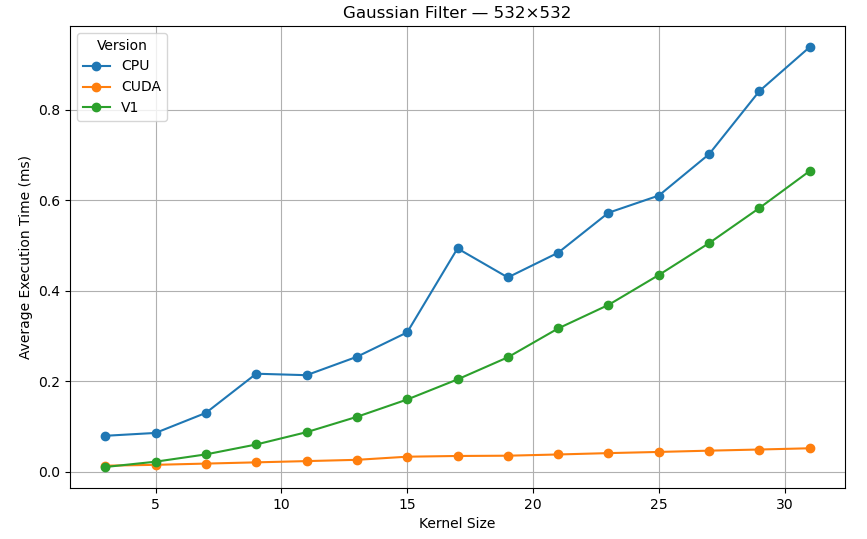</td>
  </tr>
  <tr>
    <td></td>
    <td>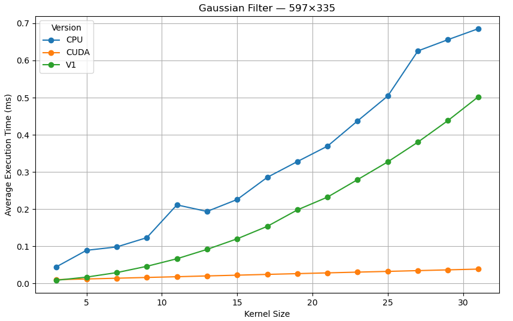</td>
  </tr>
  <tr> 
    <td></td>
    <td></td>
  </tr>
</table>


The images above show the results obtained using a Gaussian filter on five images of different sizes, with 15 different kernel sizes and a sigma value of 1.5.

The approach used is a non-optimized (naive) implementation. The filtering operation, i.e., smoothing, is applied in both image dimensions within the same nested loop, resulting in an algorithm with O(n²) complexity.

This O(n²) behavior can be observed in the graphs, where the trend becomes more pronounced as the kernel size increases.

Bellow the graph comparing, the execution time and average computation time.

</table> 

 **Average Execution Time per Image (ms)**

| Image Size | CPU (ms) | CUDA (ms) | V1 (ms) |
|------------|----------|-----------|---------|
| 453×340    | 0.262416 | 0.020690  | 0.154490 |
| 532×532    | 0.424069 | 0.033154  | 0.255565 |
| 597×335    | 0.325389 | 0.024617  | 0.192899 |
| 540×720    | 0.492039 | 0.042909  | 0.342717 |
| 1920×1080  | 1.708543 | 0.184896  | 1.587830 |

 **Overall Average Execution Time (ms)**

| Implementation | Average Time (ms) |
|----------------|-------------------|
| CPU            | 0.642491          |
| CUDA           | 0.061253          |
| V1             | 0.506700          |


The results obtained show that V1 is approximately 1.27× faster on average than OpenCV's CPU 
Gaussian filter implementation, but 8.27× slower on average than its CUDA implementation. 
Despite being a naive approach, one can observe the performance improvement achieved simply 
through parallelization.


### Gaussian V2: Separable filters 

<table>
  <tr>
    <td>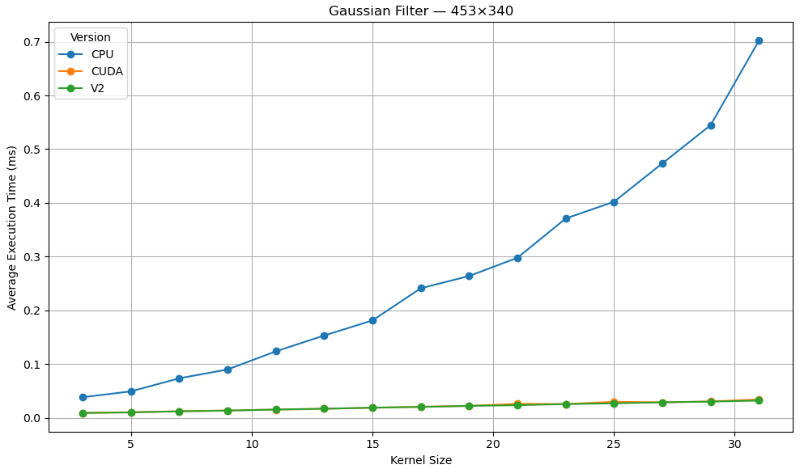</td>
    <td>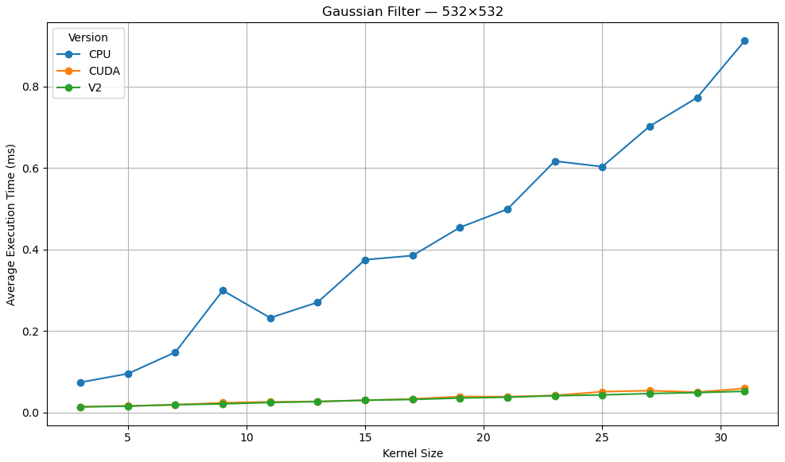</td>
  </tr>
  <tr>
    <td></td>
    <td>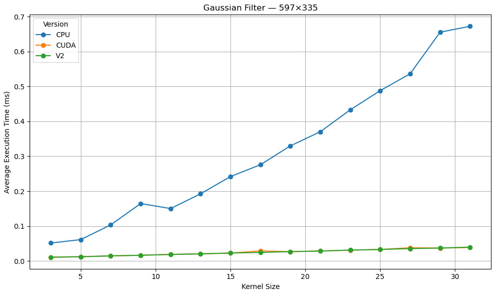</td>
  </tr>
  <tr> 
    <td></td>
    <td>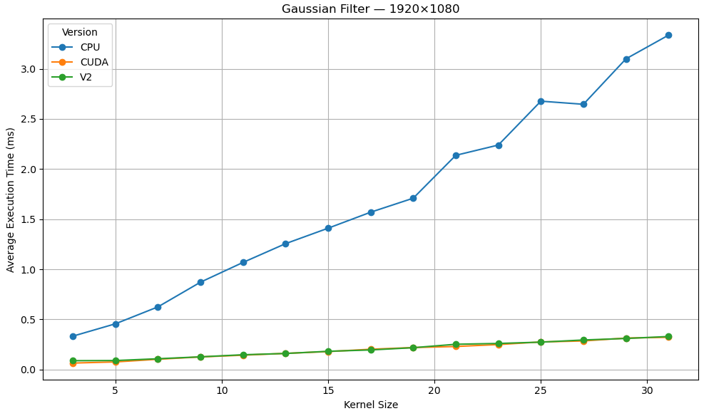</td>
  </tr>
</table>


The result above was obtained by applying separable filters. A separable filter is a filter that can be decomposed into two or more simpler filters. 
In the case of the separable Gaussian filter, the same result can be obtained by applying a vertical filter followed by a horizontal filter, or vice versa.

As expected, the result is competitive with that obtained using the CUDA implementation of OpenCV. Unlike V1, V2 has a computational complexity of O(n), where n is the kernel size. 
All subsequent versions of the Gaussian filter will use filter separability as their foundation.

</table> 

 **Average execution time per image (ms)**

| Image resolution | CPU      | CUDA     | V2       |
|------------------|----------|----------|----------|
| 453×340          | 0.267030 | 0.020965 | 0.020403 |
| 532×532          | 0.429130 | 0.034563 | 0.032190 |
| 597×335          | 0.315111 | 0.025102 | 0.024668 |
| 540×720          | 0.499446 | 0.042216 | 0.041801 |
| 1920×1080        | 1.695293 | 0.196706 | 0.202421 |

**Overall average execution time (ms)**

| Version | Average time (ms) |
|---------|-------------------|
| CPU     | 0.641202          |
| CUDA    | 0.063910          |
| V2      | 0.064297          |


The results obtained show that V1 is approximately 89.97% faster on average than OpenCV's CPU 
Gaussian filter implementation, which is a considerable improvement on V1, but 0.60% slower on average than its CUDA implementation. 
Now the power of parallelization can be fully appreciated.


### Gaussian V3: Separable filters with constant memory

<table>
  <tr>
    <td>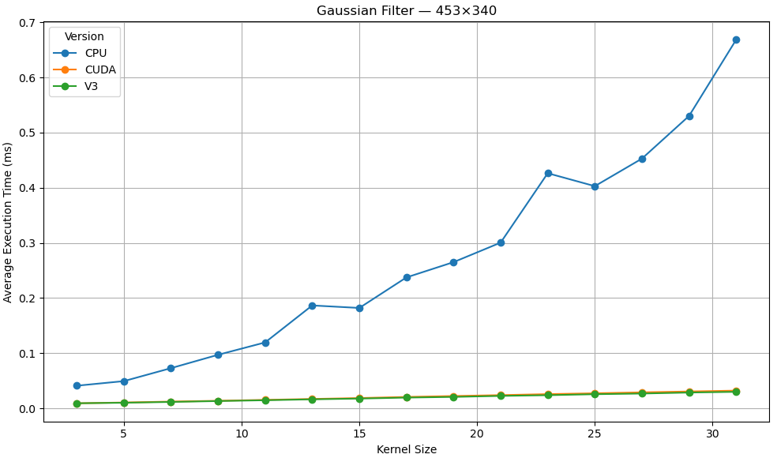</td>
    <td>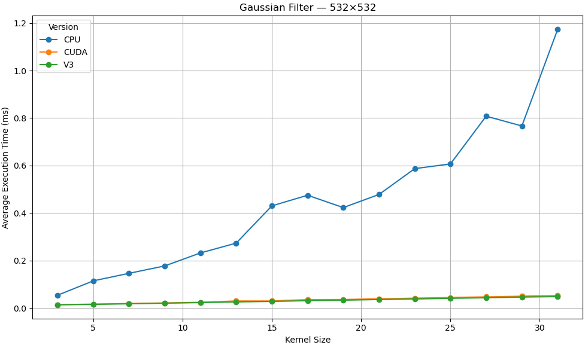</td>
  </tr>
  <tr>
    <td>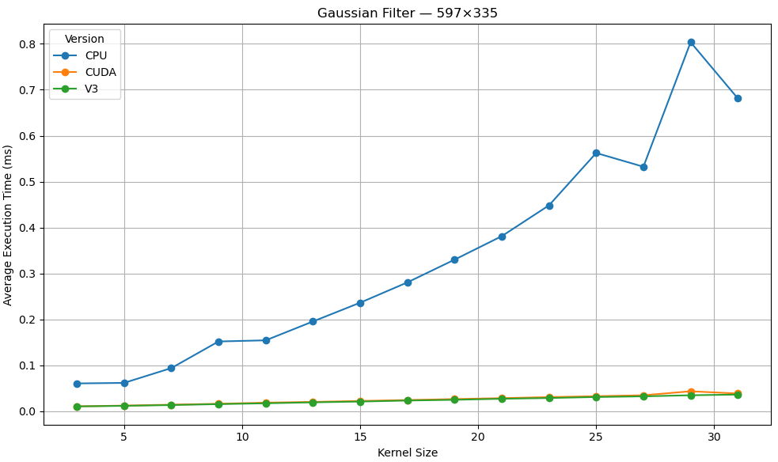</td>
    <td>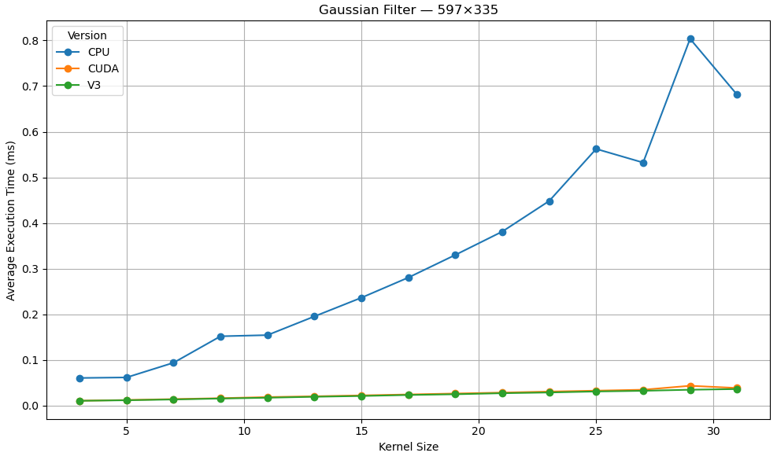</td>
  </tr>
  <tr> 
    <td>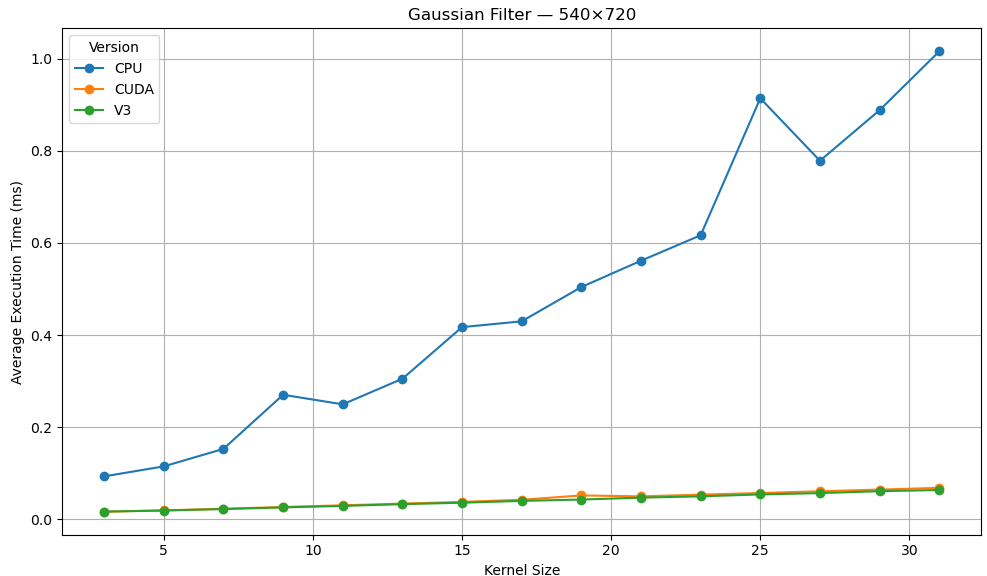</td>
    <td>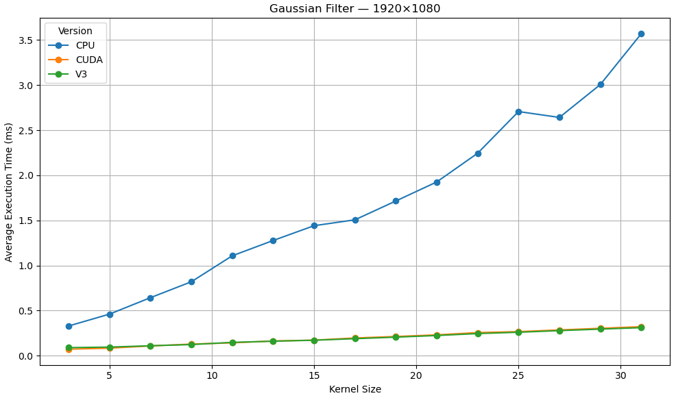</td>
  </tr>
</table>

The result above was obtained by applying separable filters with constant memory.
An obvious optimization arises from the fact that the filter coefficients remain unchanged throughout execution.
In the previous approaches, V1 and V2, the filter coefficients are accessed from global memory, which generally has high latency.
Constant memory is a read-only memory space with a dedicated cache, making it particularly efficient when threads within a warp access the same address, as is the case in our implementation.


**Average execution time per image (ms)**

| Image resolution | CPU      | CUDA     | V3       |
|------------------|----------|----------|----------|
| 453×340          | 0.268790 | 0.020493 | 0.019336 |
| 532×532          | 0.449633 | 0.033178 | 0.030482 |
| 597×335          | 0.331683 | 0.025091 | 0.023328 |
| 540×720          | 0.487515 | 0.042693 | 0.040084 |
| 1920×1080        | 1.692974 | 0.196488 | 0.193848 |

**Overall average execution time (ms)**

| Version | Average time (ms) |
|---------|-------------------|
| CPU     | 0.646119          |
| CUDA    | 0.063588          |
| V3      | 0.061415          |

The results obtained show that V3 reduces the average execution time by approximately 90.49% compared to OpenCV's CPU Gaussian filter implementation, which represents a considerable improvement. 
Furthermore, V3 is approximately 3.42% faster than OpenCV's CUDA implementation in terms of execution time. 


## Development Status

The project currently prioritizes:

1. Implementing functional CUDA image-processing algorithms.
2. Exploring and comparing different GPU optimization strategies.
3. Validating results against reference implementations.
4. Benchmarking and profiling CUDA kernels.
5. Maintaining a clear and reusable C++ project structure.

Further documentation, benchmark results, and implementation details will be added as development progresses.
